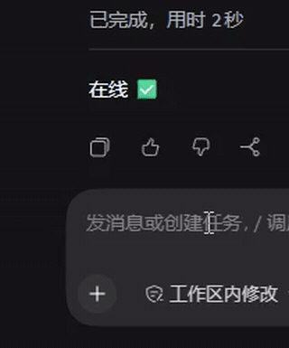

# dsh-spinner-words

[](https://www.npmjs.com/package/dsh-spinner-words)
[](LICENSE)
[](https://dsh-plugin.org/plugins/uuicdown/dsh-spinner-words)

把 DeepSeek Harness 思考状态行的那句「深度求索中」，换成一池双语短语，每回合抽一条：Claude Code 原版 spinner 词、鲸鱼系 deep 短语、中国本土文化词。

纯前端插件，不改 DSH 源码，不占用渲染插槽。


运行中的状态行。



## 安装

从 npm 装（[包页面](https://www.npmjs.com/package/dsh-spinner-words)）：

```bash
dsh plugin --profile desktop add dsh-spinner-words
```

从 GitHub 装：

```bash
dsh plugin --profile desktop add git+https://github.com/uuicdown/dsh-spinner-words.git
```

本地开发想直接链目录，用 `install.ps1`。

装完要完全退出 DSH 进程再启动，关掉窗口不算。

## 它做什么

- 一回合一个词：每轮请求开场抽一条，整轮不变，和 Claude Code 一样，思考期间不会反复换词。
- 中英双语一一对应：点击状态行切换语言，换的是同一条短语，不会重新抽取；选择记在 `localStorage`，重载后恢复。
- 注脚不占状态行：29 条典故词带完整英文注脚（如「凿壁偷光」→ boring a hole in the wall to steal a neighbor's lamplight），只在悬停时显示。
- 词池可以自己改：双击状态行或按 `Alt+E` 打开编辑器，一行一条增删改，下个回合生效。

## 词池构成（287 条）

| 段 | 条数 | 举例 |
| --- | ---: | --- |
| 鲸鱼系 deep | 13 | `深潜中` / `跃出海面中` / `海底冒泡中` |
| Claude Code spinner verbs | 158 | `正在搭架子` / `正在掂量` / `正在爆炒` |
| 中国本土 · 雅 | 86 | `凿壁偷光中` / `庖丁解牛中` / `一蓑烟雨中` / `正在望月` |
| 中国本土 · 俗 | 30 | `带薪思考中` / `憋大招中` / `已读乱回中` |

完整清单见 [`REVIEW.md`](REVIEW.md)，由 `make-review.mjs` 从 `client.js` 的词池直接生成，和代码逐字一致。

## 操作

| 操作 | 效果 |
| --- | --- |
| 单击状态行 | 中文 ⇄ English，同一条短语换语言 |
| 双击状态行 / `Alt+E` | 打开词池编辑器 |
| 控制台 `window.__dshSpinnerWordsEditor()` | 兜底入口 |

## 自定义词池

编辑器里一行一条，格式 `英文 | 中文`，`#` 开头是注释，空行忽略：

```
deep diving | 深潜中
chipping through the wall | 正在凿壁偷光 | boring a hole in the wall for a neighbor's lamplight
只有中文也可以
```

- 第三段可选，是悬停注脚，不进状态行。
- 保存写在 `localStorage`（键 `dsh-spinner-words:custom`），下一个回合起生效；「恢复默认」清空覆盖。
- 保存后整份词池以你的版本为准，内置池升级不会合并进来。想拿新词，先点「恢复默认」再改一遍。

## 实现

状态行的文案有两处载体：底层是文本节点，高光层是 `data-shimmer-text` 属性，由 CSS `::after` 画出来。插件两处都写，并同步屏幕阅读器节点。React 每秒重渲、把用时写回文本时，`characterData` 监听会立刻恢复，不会闪回内置文案。

图标、动效、尺寸、颜色都不动，小鲸鱼保持 DSH 自带的游动。

## 兼容与降级

| DSH 若这样改 | 后果 |
| --- | --- |
| 改掉内置文案（当前：中文「深度求索中」/ 英文「Deep diving」） | 插件不再生效，不报错，界面正常 |
| 改掉 `data-chat-running` / `data-shimmer-text` / `data-chat-flow-kind` | 部分失效或完全不生效，界面正常 |
| 给状态行本身加上点击行为 | 会被插件的捕获阶段监听 `stopPropagation()` 拦下，该行为不生效（点一下仍然只切换语言） |

## 与 dsh-deep-verbs 二选一

两个插件抢同一个状态行节点，同时启用会互相回写、文案抖动。要用本插件，先在 profile 的 `cordis.patch.yml` 里把对方的 `insert` 移除，或标 `disabled: true`。

## 词表来源

- Claude Code spinner verbs：取自 Claude Code 2.1.121 的提取记录，179 条里保留 158 条，去掉约 20 条过难词和 1 条品牌梗。
- 鲸鱼系 13 条：来自 [`dsh-deep-verbs`](https://github.com/Winter-And-You-Gone/dsh-deep-verbs)（MIT）。实现思路也参考了它。
- 中国本土文化段：原创，成语、典故、诗词意象，加上生活和网络用语。

## 开发

见 [`DEVELOPING.md`](DEVELOPING.md)。一句话版本：`node verify.mjs`，21 项断言，用 `node:vm` 驱动真实 bundle，不需要浏览器。

## License

MIT © 2026 Soren (uuicdown)
